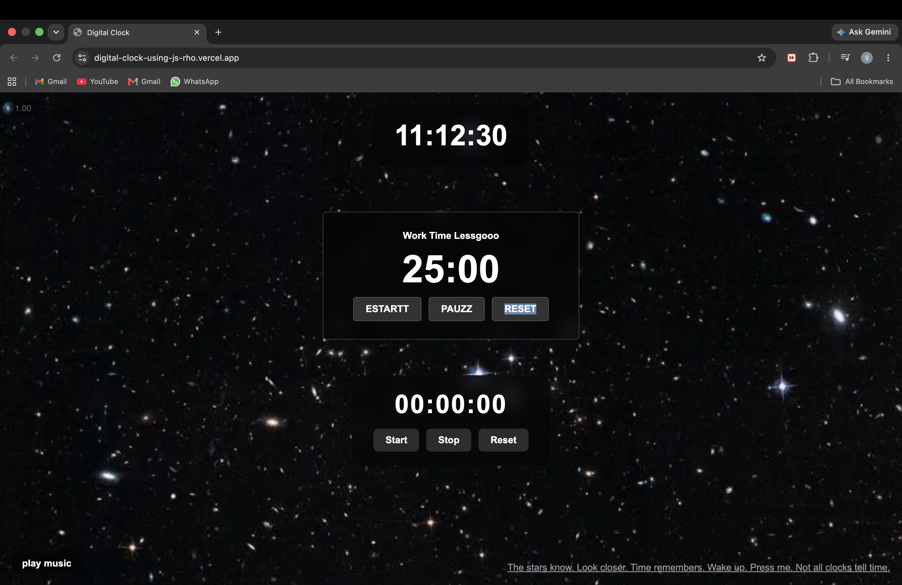

COSMIC POMODOROO

Desciption:

This is a focus app/pomodoroo app i made in JavaScipt for myself.
I originally started by making a Digital clock using js and then decided to turn it into something i could really use so i made this pomodoroo. I have added things like a cosmic music playlist in the background, a stopwatch for taking breaks so i have a count of how much time im studying and how much time i take breaks for, also im planning to add a lot of new features such as connecting spotify to it and change or add custom wallpapers.

Screenshots:

    

Getting started:

Dependencies:

1. Html
2. Css
3. Js

Installing :
1. Download the project from the repo.
2. Open the project files.

Executing the program:
Run the project in your browser.

I hope u like it :) 
